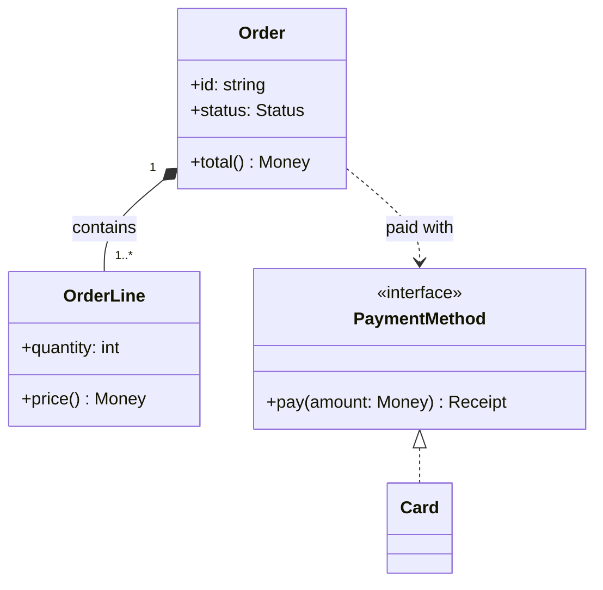
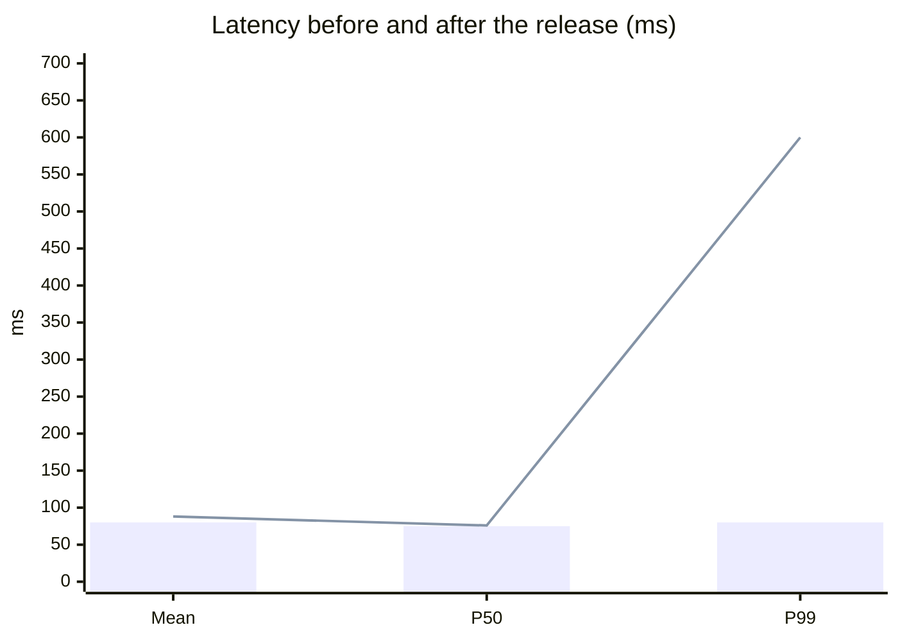

# Mermaid diagrams in relay

- **No chart library, no JS of your own.** Mermaid is the one exception, and it
  is relay's, not yours: a `mermaid` fence is drawn by the window itself.
  Anything else is hand-written SVG or HTML/CSS (see relay-html).

A fence marked `mermaid` arrives as a picture, in a box like a table, in the
window's colours. Mermaid does the layout, so there are no coordinates to get
wrong — for a class diagram, a flowchart or a sequence diagram, this is the
shortest way to a correct picture.

- **Every kind Mermaid knows is drawn.** Class diagrams, flowcharts and sequence
  diagrams are the ones tested in the window.
- **The look is locked.** The theme, the colours, the font, the layout (always
  dagre) and `securityLevel` (`strict`) are relay's. A `%%{init: …}%%` line or a
  `config:` header that sets them changes nothing, so do not write one. `style`
  and `classDef` lines still paint; if you use them, take the colours from the
  palette in relay-html.
- **A broken diagram stays as code**, with one red line under the closing fence:
  `diagram not drawn — line 97: Expecting 'STR', 'ALPHA', … got 'LINE'`. The
  line number is the document's, so `:97` goes to it. **You never see that line;
  the user does.** Write only syntax you are sure of — a broken fence costs the
  user the picture.
- **The caret works as for any block.** `j`/`k` step over it; `:17` or
  `/pattern` gets into it, and it shows as code while the caret is there. Once
  the fence is edited, it stays code.
- **Keep it small.** An eight-box `flowchart TD` came out 990 px tall — more than
  most windows show at once. Split a big picture, or say it in a table.
- A class with fields and no methods still gets an empty methods box. That is
  UML's three parts, and GitHub draws it the same way — not a mistake to fix.

## Charts

Mermaid also draws charts from numbers, in the window's colours. Reach for one
when the point is a contrast in numbers; it beats hand-built HTML bars.

| Numbers | Chart |
| --- | --- |
| compared across items, or over time | `xychart-beta` — `bar` and `line` |
| shares of a whole | `pie` |
| items placed on two scales, a 2×2 | `quadrantChart` |
| a quantity splitting into flows | `sankey-beta` |

- Each series takes the next colour in a fixed order — blue, peach, green,
  mauve — so a bar chart and a pie of the same numbers match.
- Quote every label with a space in it. Say where the numbers come from:
  measured, estimated or made up.
- `quadrant-1` is the top right, then counter-clockwise: 2 top left, 3 bottom
  left, 4 bottom right. Points are `Name: [x, y]`, both from 0 to 1.
- `sankey-beta` takes CSV rows, `source,target,value`, with no indent.

## Before you launch

- Mermaid written in syntax you are sure of, with no `%%{init}%%` line.
- A chart's numbers say where they come from.
- Colours from the palette in relay-html.
